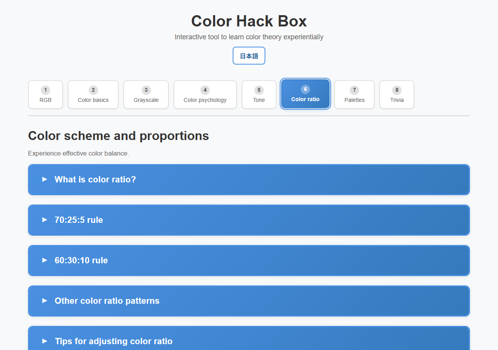

English · [日本語](README.md)

# Color Hack Box - A learning tool for the three elements of color


[](https://ipusiron.github.io/color-hack-box/)

**Day101 - 200 security tools made with generative AI**

**Color Hack Box** is an educational tool for interactively learning the three elements of color: hue, lightness, and saturation.

By simply moving the sliders, you can intuitively understand how HSL (hue, saturation, and lightness) affects the appearance of colors.

Color code display in HEX, RGB, and HSL formats allows for use in design practice.

---

## 💡 Design is about knowledge, not taste

Have you given up because you don't have a sense of design?

**Color matching is not a talent; it is a skill that can be learned.** The color wheel, complementary relationships, tone theory, and color ratios are systematic knowledge that anyone can learn.

This tool is designed to help you learn color theory as a "logic" rather than a "feel". Move sliders, check numbers, and discover regularities. This repetition will develop solid coloring skills.

**With study, anyone can create beautiful color schemes.**

---

## 🌐 Demo page

👉 **[https://ipusiron.github.io/color-hack-box/](https://ipusiron.github.io/color-hack-box/)**

You can try it directly in your browser.

---

## 📸 Screenshot

>
>*Explanation of color ratio*

---

## 🎯 Purpose

It is developed for the following purposes.

- **Basic color education**: Visually understand the relationship between hue, lightness, and saturation
- **3D understanding of RGB color space**: Intuitively understand RGB values ​​as 3D vectors
- **Intuitive learning experience**: Instant feedback with slider controls
- **Practical application**: Learn how to specify colors in HEX/RGB/HSL format
- **Design assistance**: Used as a quick reference when considering color schemes

---

## 👥 Target audience

- **Beginners in Design**: Those who want to learn the basics of color theory
- **Web developer**: Those who want to understand how color codes work
- **Designer**: As a reference tool when considering color schemes
- **Educator**: Those who want to use it as a teaching material for color education

---

## 📚 Usage examples

### 1. Color theory instruction in design education
It can be used as a practical teaching material when teaching the three elements of color at vocational schools and design schools.
In addition to the explanations, the sliders let you experience how changes in hue, lightness, and saturation affect the impression of a color.
In particular, learners can immediately confirm concepts such as “setting saturation to 0 produces an achromatic color” and “changing lightness can make the same hue look entirely different.”

### 2. Consideration of color scheme in website/application UI design
Web designers and front-end developers can use it as a reference tool when deciding on the color scheme for their sites and apps.
For example, you can create variations of a brand color by adjusting lightness and saturation, or inspect complementary-color relationships.
Since color codes are displayed in HEX, RGB, and HSL formats, they are practical and can be used directly in CSS and design tools.

### 3. Color adjustment for accessibility verification
Calculate WCAG 2.2 contrast ratios and check AA/AAA thresholds for normal and large text, plus the 3:1 non-text threshold. When a target is not met, the tool proposes one pair adjusted toward black or white; you can apply or copy it. A suggested pair is only one calculated option, and a two-color result does not prove whole-page WCAG conformance.
For palettes of 2 to 8 colors, inspect every pair at once and compare the original palette with protanopia, deuteranopia, and tritanopia approximations. These approximations are review aids; they do not reproduce an individual's color perception and cannot be used for medical diagnosis or WCAG conformance decisions. The tool also demonstrates designs that combine color with text, shapes, and patterns.

## 🎨 Features

### 📑 8 tab configuration

This tool allows you to systematically learn color theory in 8 tabs (all 60 accordion-style explanations):

#### 1️⃣ Tab 1: RGB Color Space
- **RGB slider**: Adjust red, green, and blue individually from 0 to 255
- **3D RGB Cube**: Visualize RGB color space in 3 dimensions (can be rotated by dragging)
- **Display point within cube**: Shows where the current color is located within the cube
- **Preset & Corner Button**: Select primary color/vertex color with one click
- **Color similarity calculation**: Calculate cosine similarity and Euclidean distance between two colors
- **3D comparison view**: Visualize the position and distance within the cube of two colors

#### 2️⃣ Tab 2: Basics (three elements of color)
- **Interactive slider**: Real-time adjustment of hue, lightness, and saturation
- **Color code display**: Instant conversion in HEX, RGB, and HSL formats
- **One-click copy**: Copy color code to clipboard
- **Random generation/reset**: Easy color exploration and initialization
- **Detailed explanation**: Explains the role and usage of each attribute using 6 accordions

#### 3️⃣ Tab 3: Neutral and Grayscale
- **Grayscale slider**: Generates achromatic colors from black to white
- **Preset button**: Instantly set pure white, light gray, middle gray, dark gray, pure black
- **Practical explanation**: Role of achromatic colors, contrast ratio, HEX code, monochrome design examples
- **Contrast inspection**: Displays WCAG 2.2 ratio, AA/AAA, non-text 3:1 judgment from foreground and background colors
- **Color scheme candidates**: If the selected criteria are not met, candidates that meet the criteria are generated and reflected/copied.
- **Explanation of judgment range**: Clarify items that cannot be confirmed with just two-color calculations, such as font size, state changes, adjacent colors, images/gradations, etc.

#### 4️⃣ Tab 4: Impression and psychology of colors
- **Psychological effects by color**: Explaining the psychological effects of 9 colors: red, blue, green, yellow, orange, purple, pink, black and white.
- **Associative tags**: Visualize positive, neutral, and negative impressions
- **Color variations**: Display examples of changing the lightness and saturation of each color
- **Usage scene**: Color scheme advice by industry/purpose

#### 5️⃣ Tab 5: Palette by tone
- **Tone Map**: Visualize 9 tones of lightness x saturation (pale, vivid, dull, deep, etc.)
- **Color grid by tone**: Displays a list of color samples for each tone
- **Coloring techniques**: Examples of same tone coloring and gradation coloring

#### 6️⃣ Tab 6: Color scheme and proportions
- **Rule of 70:25:5**: Golden ratio of base, main and accent colors
- **60:30:10 pattern**: Well-balanced 3 color scheme
- **Visual ratio bar**: Experience the actual area ratio
- **Example demo**: Website style color layout

#### 7️⃣ Tab 7: Color scheme examples/Palettes by purpose
- **50+ color palettes**: Corporate, EC, blog, portfolio, etc.
- **Industry Palette**: Medical, Education, Food and Beverage, IT, Finance, Entertainment
- **Seasonal Palette**: Typical color schemes for spring, summer, fall, and winter
- **Palette by mood**: 8 types including trustworthy, energetic, gentle, luxurious, etc.
- **HEX code display**: Color code that can be used immediately in practice

#### 8️⃣ Tab 8: Trivia/Supplements
- **Cultural Differences in Colors**: Different meanings of red, white, yellow, and green in different cultures
- **Color-vision approximations**: Compare the original palette with protanopia, deuteranopia, and tritanopia approximations using the severity 1.0 matrices from Machado et al. (2009)
- **Palette batch inspection**: List the numerical standards of normal text 4.5:1 and 3:1 for all combinations of 2 to 8 colors
- **Clues other than color**: Design examples that use shapes, characters, line types, patterns, and direct labels
- **RGB vs CMYK**: Differences in color representation between screen and print
- **Web Safe Colors**: Historical and Modern Significance
- **Color temperature**: Psychological and physiological effects of warm and cool colors
- **Web color keywords**: 140+ color names that can be used in CSS
- **Color illusion effect**: simultaneous contrast, area effect, advancing and receding colors
- **Gamma correction**: Display characteristics and practical implications

### 🎯 Interactive features

- **3D RGB Cube**: Rotate by dragging and display color position in real time (Tab 1)
- **Color similarity calculation**: Visualize vector comparison of two colors on a cube (Tab 1)
- **Complementary color hue wheel**: Highlight complementary color pairs on hover (Tab 2)
- **Hue wheel of similar hues**: Interactive display of similar colors at 30 degrees adjacent (Tab 2)
- **Color-vision simulation**: Compare the original palette and three approximations with numerical ratios and HEX values (Tab 8)
- **Palette Audit**: Calculate all pairs of up to 8 colors at once and narrow down unmet combinations (Tab 8)
- **Toast Notification**: Feedback when copying is successful
- **Responsive design**: Fully compatible with mobile (600px), tablet (768px) and desktop
- **Keyboard operation**: Tabs can be moved using the left and right arrow keys, Home, and End.

### 🛠️ Technical specifications
- **Color conversion algorithm**: Implemented HSL⇔RGB⇔HEX bidirectional conversion
- **3D visualization**: Interactive display of RGB cubes with CSS 3D transform
- **Similarity calculation**: Color comparison function using cosine similarity and Euclidean distance
- **Color vision approximation model**: Machado, Oliveira, and Fernandes (2009) severity 1.0 matrices
- **Accordion UI**: 60 collapsible explanation sections
- **Zero dependencies**: Pure HTML/CSS/JavaScript (no build required)
- **In-browser processing**: The input color is not sent externally, and no third party script is loaded.

## 🚀 How to use

### set up

No dependencies or build tools required. You can use it immediately if you have an up-to-date web browser.

1. **Clone the repository**:
```bash
git clone https://github.com/ipusiron/color-hack-box.git
cd color-hack-box
```

2. **Start on local server** (required):

> **Note**: This application loads tab content dynamically, so access via an HTTP server is required. Does not work with `file://` protocol.

```bash
# For Python 3
python -m http.server 8000

# Node.js (if http-server is already installed)
npx http-server
```

Then access `http://localhost:8000`

### Basic usage

1. **Adjust the sliders**: Move the Hue, Lightness, and Saturation sliders.
2. **Check the color**: Check the color change in real time with the color chip
3. **Get code**: Copy and use the color code in HEX/RGB/HSL format
4. **Random Generation**: Explore new colors with the “Random Generation” button
5. **Reset**: Return to initial state using the "Reset" button
6. **Learn**: Learn about color theory by expanding on “What are the three attributes of color?”

### Test

Can be run on Node.js 22 and later without installing any additional packages.

```bash
npm test
```

---

## 📁 Directory structure

```
color-hack-box/
├── .github/workflows/ # Node.js automated testing
├── index.html # Japanese shell HTML
├── index.en.html # English shell HTML
├── color-core.js # WCAG contrast calculation (DOM independent)
├── accessibility-core.js # Color vision approximation/palette batch inspection (DOM independent)
├── language-init.js # Language selection, storage, and initial redirect
├── ui-messages.js # Japanese/English dynamic message catalog
├── script.js # JavaScript (TabLoader, PaletteRenderer, color conversion logic)
├── style.css # Style sheet (layout, responsive)
├── tabs/ # Tab content (lazy loading)
│ ├── tab1-rgb.html # RGB color space
│ ├── tab2-basics.html # Three elements of color (basics)
│ ├── tab3-grayscale.html # Achromatic color/grayscale
│ ├── tab4-psychology.html# Color impressions and psychology
│ ├── tab5-tone.html # Palette by tone
│ ├── tab6-ratio.html # Color scheme and ratio
│ ├── tab7-palettes.html # Color scheme example (data-driven template)
│ ├── tab8-misc.html # Trivia/Supplements
│ └── en/ # English versions of all eight tabs
├── data/
│ ├── palettes.json # Japanese palette data
│ └── palettes.en.json # English palette data
├── assets/ # Resources such as images (screenshots, etc.)
├── test/ # Node.js standard test
├── package.json # test command
├── LICENSE # MIT License
├── README.md # Japanese documentation
├── README.en.md # This file
├── CLAUDE.md # Development guide for Claude Code
└── .nojekyll # GitHub Pages settings
```

### Architecture

The tool has a modular architecture:

- **Lazy Loading**: Tab content is dynamically loaded with `fetch()` on click
- **Cache mechanism**: Once loaded tabs do not need to be reloaded
- **Data-driven**: Tab 7 palette is generated from `palettes.json`
- **Separation of calculation and display**: Contrast calculation and color vision approximation/batch testing are tested as DOM-independent modules

---


## 📄 License

MIT License – See [LICENSE](LICENSE) for details.

---

## 🛠️ About this tool

This tool was developed as part of the "200 Security Tools Made with Generative AI" project.
This project uses the support of AI to create and publish various tools related to security.

For more information about the project and other tools, please visit the following pages:

🔗 [https://akademeia.info/?page_id=44607](https://akademeia.info/?page_id=44607)
